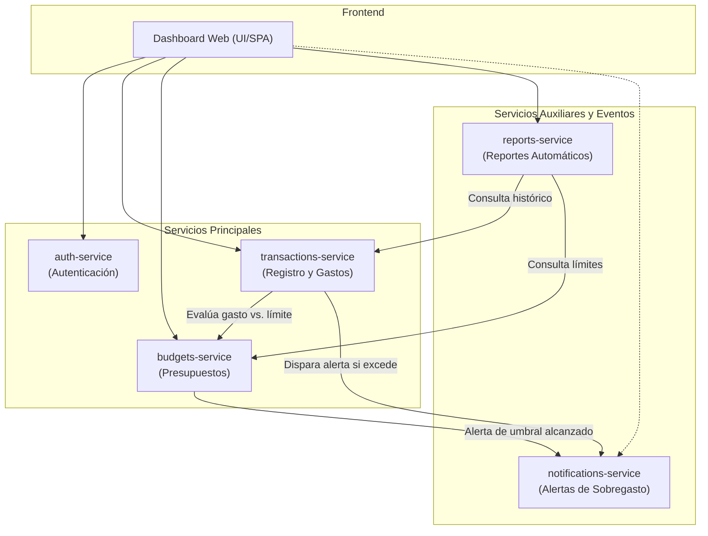

# Centavo 🪙

**Centavo** es una aplicación de finanzas personales diseñada para uso individual. Permite registrar y categorizar gastos, establecer presupuestos y recibir alertas oportunas de sobregasto, además de generar reportes automáticos sobre la salud financiera personal.

El proyecto está organizado como un **monorepo** compuesto por un frontend (dashboard) y cinco microservicios desacoplados e independientes.

---

## 🏛️ Arquitectura del Sistema

La arquitectura está basada en microservicios, donde el cliente web (dashboard) interactúa con las distintas piezas especializadas de negocio:



---

## 🧩 Componentes y Responsabilidades

Cada pieza del sistema reside en su propia carpeta dentro del repositorio y cuenta con responsabilidades claramente delimitadas:

### 1. `frontend/` (Dashboard)
- **Propósito:** Interfaz de usuario interactiva y responsiva para el usuario.
- **Responsabilidades:**
  - Visualización del resumen financiero (gastos del mes, balance general, estado de presupuestos).
  - Formularios para el registro rápido de ingresos y gastos.
  - Paneles de configuración de presupuestos y límites por categoría.
  - Centro de notificaciones y alertas en tiempo real.
  - Visualización y descarga de reportes periódicos.

### 2. `auth-service/`
- **Propósito:** Control de acceso, identidad y seguridad.
- **Responsabilidades:**
  - Registro, inicio de sesión y gestión de credenciales del usuario.
  - Emisión y validación de tokens de autenticación (JWT).
  - Protección de rutas e información personal.

### 3. `transactions-service/`
- **Propósito:** Núcleo de registro y gestión de movimientos financieros.
- **Responsabilidades:**
  - Registro de transacciones (gastos e ingresos) con fecha, monto, medio de pago y notas.
  - Categorización de gastos (alimentación, transporte, vivienda, ocio, etc.).
  - Filtros, búsqueda y listado paginado de transacciones.
  - Emisión de eventos o solicitudes al registrar gastos para verificar límites presupuestarios.

### 4. `budgets-service/`
- **Propósito:** Definición y seguimiento de presupuestos.
- **Responsabilidades:**
  - Creación de presupuestos mensuales o personalizados por categoría o globales.
  - Cálculo de porcentaje consumido y monto restante en tiempo real.
  - Determinación de estados de riesgo (ej. 80% alcanzado, 100% excedido).

### 5. `notifications-service/`
- **Propósito:** Comunicación y alertas proactivas al usuario.
- **Responsabilidades:**
  - Recepción de alertas de sobregasto emitidas por el servicio de transacciones o presupuestos.
  - Notificaciones en la interfaz (in-app) o por canales externos (correo, webhooks, etc.).
  - Historial de avisos y gestión de estados de lectura.

### 6. `reports-service/`
- **Propósito:** Análisis, agregación de métricas y reportería periódica.
- **Responsabilidades:**
  - Generación de reportes automáticos (semanales, mensuales o anuales).
  - Agrupación y cálculo de tendencias de consumo, hábitos de gasto y comparativas temporales.
  - Exportación de balances a formatos descargables (PDF, CSV).

---

## 📁 Estructura del Monorepo

```text
Centavo/
├── frontend/                  # Aplicación cliente (Dashboard)
├── auth-service/              # Servicio de autenticación y usuarios
├── transactions-service/      # Servicio de registro y categorización de gastos
├── budgets-service/           # Servicio de gestión y monitoreo de presupuestos
├── notifications-service/     # Servicio de envío y gestión de alertas
├── reports-service/           # Servicio de agregación y reportes automáticos
└── README.md                  # Documentación general del proyecto
```

---

## 🚀 Flujo de Trabajo Principal

1. **Autenticación:** El usuario inicia sesión a través del `frontend` contra `auth-service`.
2. **Registro de Gasto:** El usuario registra una nueva transacción en el `frontend`, la cual se almacena en `transactions-service`.
3. **Control de Presupuesto:** `transactions-service` y `budgets-service` coordinan la actualización del balance consumido para esa categoría.
4. **Detección y Alerta:** Si el gasto sobrepasa el límite presupuestado, se emite una alerta a `notifications-service`, mostrando el aviso al usuario.
5. **Cierre y Reportería:** Periódicamente o bajo demanda, `reports-service` procesa los datos agregados para ofrecer gráficos y resúmenes financieros.
